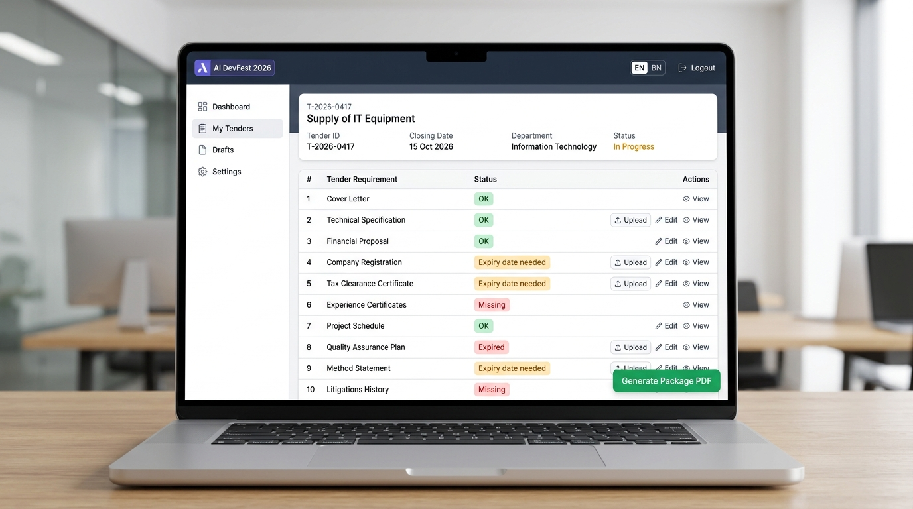

# Tender Document Package Builder (দরপত্র নথি প্যাকেজ নির্মাতা)

> **AI DevFest 2026 — AI Vibe-Coding Contest (Solo)**  
> **Organizer**: Computer and Programming Club (CPC), Department of Computer Science & Engineering, Daffodil International University  
> **Supported by**: Center for Software Development & Emerging Tech (CSE-TECH)

---

## 📌 Participant Information
- **Participant Name**: Aftab Hosen
- **Registration Number**: cmu0h4hnq0018o0knfnsdurt5
- **Repository Link**: [https://github.com/aftab168/Tender-Document-Package-Builder](https://github.com/aftab168/Tender-Document-Package-Builder)
- **Live HTTPS Deployment Link**: [https://aftab168.github.io/Tender-Document-Package-Builder/](https://aftab168.github.io/Tender-Document-Package-Builder/)

---

## 🎯 Project Overview
**Tender Document Package Builder** is a client-side frontend web application designed for office staff to assemble, validate, order, and package complex tender bid PDF documents without requiring technical expertise.

It automates verification of requirements, checks document expiry against submission deadlines, flags duplicate documents, generates professional branded cover pages and table of contents, and produces a single unified submission package with universal footers on every page.

---

## 📸 Screenshots & Status Verification



---

## 🚀 How to Run the Application

### Option 1: Access Live Deployment (Zero Installation)
Visit the live site: **[https://aftab168.github.io/Tender-Document-Package-Builder/](https://aftab168.github.io/Tender-Document-Package-Builder/)**

### Option 2: Run Locally
Ensure **Node.js (v18+)** is installed:

```bash
# 1. Clone the repository
git clone https://github.com/aftab168/Tender-Document-Package-Builder.git
cd Tender-Document-Package-Builder

# 2. Install dependencies
npm install

# 3. Start development server
npm run dev

# 4. Build for production
npm run build
```

---

## ✅ Main Features Completed (Rulebook Section 4 & Section 5)

1. **Requirements Loading (Section 4.1)**:
   - Supports uploading any standard `requirements.json` file or loading the built-in official sample tender with one click.
   - Displays tender metadata (Tender ID, Title, Procuring Entity, Bidder, Submission Deadline).
   - Renders all 10 document requirements sorted strictly by `order`.

2. **Multi-File PDF Upload & Verification (Section 4.2)**:
   - Multi-file drag-and-drop pool supporting up to 50 MB total.
   - Accurately counts pages for each PDF and shows file size.
   - Non-PDF files are safely rejected with clear validation notices.

3. **1-to-1 Document Matching (Section 4.3)**:
   - Strict one-to-one mapping constraint: One requirement gets at most one file; one file is assigned to at most one requirement.
   - Easy dropdown assignment and 1-click unmatching.

4. **Expiry Date Validation (Section 4.4 & Section 5)**:
   - Interactive date selection for all documents marked with `has_expiry = true`.
   - Real-time evaluation against the tender `submission_deadline`.
   - Strict status rules:
     - `Missing`: Mandatory requirement with no file attached *(Blocks Package)*.
     - `Expiry date needed`: File attached to expiry-required document but date not set *(Blocks Package)*.
     - `Expired`: Document expires prior to `submission_deadline` *(Blocks Package)*.
     - `Not provided`: Optional document without file *(Allowed)*.
     - `OK`: Valid file attached and expiry date is on or after submission deadline *(Allowed)*.

5. **SHA-256 Duplicate Content Detection (Section 4.6)**:
   - Evaluates cryptographic SHA-256 hash of all uploaded documents.
   - Automatically detects identical content files (e.g. `experience_cert.pdf` vs `experience_cert (1).pdf`), tags them with warning badges, and prevents assigning duplicate copies.

6. **Automated Package Generation & Download (Section 4.7 & 4.8 & Section 6)**:
   - Disables generation button whenever blocking issues exist, clearly highlighting reasons.
   - Generates unified PDF package `<tender_id>_Package.pdf` (e.g., `T-2026-0417_Package.pdf`).
   - **Page 1: Branded Cover Page** with tender info, bidder details, company logo, and summary checklist.
   - **Page 2: Table of Contents / Index** with exact start/end page numbers.
   - **Universal Footer**: `<tender_id> | Page X of Y` cleanly applied to every single page.

7. **Bilingual Bangla & English Support (Section 4.9)**:
   - Instant toggle between English and Bengali (`title_en` / `title_bn`).
   - 100% of labels, tooltips, buttons, table headers, and error messages translated.

---

## 🌟 Bonus Features Completed (Section 7)

- 📑 **Table of Contents (Index Page)**: Automatically generated after cover page detailing exact page ranges for every document.
- 🔏 **Digital Seal & Signature Tool**: Upload custom PNG seal or signature and apply to cover, declaration/financial proposals, or all pages.
- 📊 **Checklist Export**: 1-click export of complete requirement status checklist to **Excel (.xlsx)** and **CSV**.
- 💾 **Save & Reopen Workspace**: Export and import full project state (`.json`) and resume work without data loss.
- ⚡ **Intelligent Auto-Match**: Heuristic matching algorithm that auto-detects and suggests document mappings based on filename patterns.
- 🛡️ **Graceful Error Handling**: Resilient to corrupted, empty, or password-protected PDF files.
- 🤖 **AI Assistant Interface (Section 5.5)**: User-provided API key support for OCR assistance without hardcoded secrets.

---

## 📦 Sample Pack Resolutions (Section 9 Deliverables)

The sample pack issues were identified and resolved:
1. **Trade License Expiry**: Replaced expired `trade_license_2025.pdf` (expired 2025-06-30) with valid `trade_license_2026.pdf` (valid until 2027-06-30).
2. **Duplicate Detection**: Identified that `experience_cert (1).pdf` was identical to `experience_cert.pdf` and assigned only the master file to `R05`.
3. **Scan Matching**: Identified `scan_0042.pdf` as the official **Signed Declaration** and assigned it to `R10`.
4. **Generated Deliverable**: Saved in repository at `output/T-2026-0417_Package.pdf` (17 total pages).

---

## ⚠️ Known Problems / Limitations
- Web browser memory limitations: Very large packages (>100+ pages) may take 2-3 seconds to render in memory before triggering the download dialog.

---

## 🤖 AI Tools Used & Prompts

- **AI Coding Assistant**: Antigravity (Google DeepMind)
- **Most Useful Prompt**:
  > *"Build a complete frontend-only Tender Document Package Builder in React with Vite, pdf-lib, and Tailwind CSS that validates tender requirements, computes SHA-256 duplicate hashes, strictly validates expiry dates against the submission deadline, provides bilingual English/Bangla UI, generates a branded cover page and index with universal footers on every page, and exports Excel checklists."*

---

## 📄 License
This project is licensed under the **MIT License** — see the [LICENSE](LICENSE) file for details.
